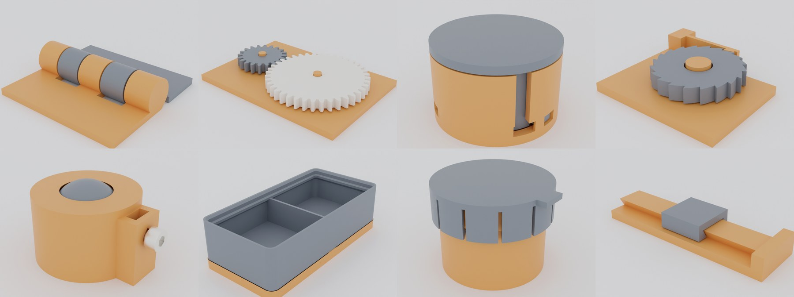

<p align="center"></p>

# LC3D

**Des pièces imprimées en 3D qui marchent du premier coup.**

LC3D conçoit des pièces imprimées en 3D avec ton IA (Claude, Kimi, Codex, Gemini…). Tu décris la pièce (ou tu envoies une photo), ton IA la construit en code, et LC3D la **vérifie avant l'impression** : impression couche par couche, montage dans l'ordre réel, clips et ressorts calculés, résistance par éléments finis, 1 000 impressions simulées. Tu reçois un 3MF prêt à imprimer, réglages dedans — ou la pièce dans ton logiciel de CAO, avec son historique.

[Français](#français) · [English](#english) · [Catalogue de composants](catalogue/)

---

## Français

### Ce que ça fait

| | |
|---|---|
| **Conçoit** | « Fais-moi une boîte avec un couvercle qui clipse » → questions qui manquent, puis la pièce, geste par geste, en direct dans **LC3D Studio** (3D dans le navigateur). |
| **Vérifie** | Murs (aussi en diagonale), fentes, surplombs, ponts, îlots, couche par couche · chaque pièce **entre** dans l'ordre de montage · jeux mesurés · force des clips et des ressorts · mouvements complets · résistance (éléments finis, faiblesse entre les couches) · 1 000 impressions simulées avec les tolérances de la machine. |
| **Livre** | Un zip, **un 3MF par pièce avec les réglages dedans** (imprimante, plateau, filament, murs, remplissage), tranché par le vrai logiciel avant d'être livré. |
| **Exporte** | FreeCAD et Autodesk Fusion **avec l'historique** (change une cote, tout suit), OpenSCAD (variables), STEP pour SolidWorks / Onshape / Inventor, IGES, STL, OBJ, GLB. |
| **Revient** | Tu modifies la pièce dans ton logiciel, tu renvoies le STEP : LC3D refait toutes les vérifications. |

### Imprimantes

Bambu Lab (P2S, X1C, X1E, P1S, P1P, A1, A1 mini, H2D…) avec les **profils de Bambu Studio** · Prusa · Creality · Snapmaker U1 (4 têtes) · Elegoo · Anycubic · Qidi · Voron · Sovol · Flashforge · Artillery… — ~1 150 machines (profils OrcaSlicer).
Multi-couleurs et multi-matériaux (AMS, têtes multiples, changeurs). Quand une combinaison est impossible sur une machine (ex. PETG + PLA sur une seule buse), LC3D le dit **avant** de faire le fichier, avec la solution.

### Les preuves

Tout est vérifié par des bancs d'essai automatiques, avec les **vrais logiciels** :

<!--PREUVES-->
- **Export CAO — pièces d'essai** : 8/8 identiques dans FreeCAD et OpenSCAD, cotes qui suivent
- **Export CAO — pièces générées au hasard** : 58/58 identiques dans FreeCAD et OpenSCAD, cotes qui suivent (2 forme(s) impossible(s) refusée(s) avec la raison)
- **Export CAO — composants du catalogue et grosses pièces complexes** : 36/36 identiques dans FreeCAD et OpenSCAD, cotes qui suivent
- **Autodesk Fusion** (lot final, toutes les pièces CAO) : 162/162 pièces, 1054 contrôles, 0 échec — exécuté dans Fusion
- **Imprimantes** : 156 essais sur 26 imprimantes — 132 tranchés sans erreur par le vrai logiciel, 24 refus expliqués, 0 échec
- **Test inverse** : 176 vraies pièces officielles (STEP de fabricants + vis/écrous/roulements ISO) ressortent identiques
- **Défauts plantés exprès (sabotage)** : 76/76 attrapés, 0 fausse alerte sur les pièces saines
- **Physique** : clips, ressorts, poutres (éléments finis), engrenages comparés aux guides publiés (Bayer/Covestro, formules d'ingénierie) — écarts de 0 à 4 %
- **À la main** : 3MF ouverts et tranchés dans Bambu Studio et Snapmaker Orca (U1), sans erreur
<!--/PREUVES-->

### Catalogue de composants

Des composants numérotés réutilisables (« mets le clip n° 1 ») : charnières, clips, baïonnettes, filets, cliquets, ressorts, engrenages, Gridfinity… Chaque fiche a son modèle 3D, ses cotes et son statut :

- **Calculé** : vérifié par LC3D, pas encore imprimé.
- **Imprimé ✓** : des gens l'ont imprimé et ça marche (photo à l'appui).
- **Signalé** : quelqu'un dit « ça marche pas » — affiché en rouge tout de suite.

→ [Ouvrir le catalogue](catalogue/) · [Ajouter ta preuve d'impression](../../issues/new?template=1-preuve.yml) · [Signaler un problème](../../issues/new?template=2-signalement.yml) · [Proposer un composant](../../issues/new?template=3-proposer.yml)

### Installer et utiliser

```bash
bash install.sh
python lc3d/lc3d.py run ma_piece.py
```

`install.sh` installe tout ce qu'il faut (Python, CadQuery, OrcaSlicer, Bambu Studio, FreeCAD — tout gratuit). Des modèles prêts à essayer sont dans [`exemples/`](exemples/).

### Avec ton IA

LC3D marche avec l'IA que tu as déjà — **Claude Code, Kimi Code, Codex, Gemini CLI**… — sans crédit à payer en plus. Dis-lui simplement :

> Va sur https://github.com/LevixiaSaaS/lc3d, prends le skill LC3D et fais-moi *une boîte avec un couvercle qui clipse, pour ma P1S*.

Ton IA fait tout le reste : elle installe LC3D, ouvre **ton Studio** (ta pièce en 3D, en direct, dans le navigateur — gratuit), te pose les questions qui manquent, construit la pièce, la vérifie et te donne le 3MF prêt à imprimer. Pour la retrouver plus tard : « rouvre mon Studio ».

Le mode d'emploi que suit ton IA est dans [SKILL.md](SKILL.md).

### Ce que LC3D ne prouve pas

La fatigue, les chocs et le fluage dans le temps · les cotes exactes de **ta** machine tant que la calibration n'est pas faite · l'esthétique. Le rapport de chaque projet dit ce qui a été vérifié et ce qui ne l'a pas été.

## Licence

MIT — libre d'utiliser, de modifier et de redistribuer, en gardant l'avis de licence. Voir [LICENSE](LICENSE).

---

## English

LC3D designs 3D-printed parts **and verifies them before printing**: layer-by-layer printability, assembly in the real order, computed snap-fits and springs, finite-element strength, 1,000 simulated prints. You get a ready-to-print 3MF with settings inside (sliced by the real slicer before delivery) — or the part in your CAD software with its full history: FreeCAD and Autodesk Fusion (parametric), OpenSCAD (variables), STEP for SolidWorks / Onshape / Inventor.

~1,150 printers (Bambu Lab with Bambu Studio's own profiles, Prusa, Creality, Snapmaker U1, Elegoo, Anycubic, Qidi, Voron…), multi-color and multi-material, with impossible combinations explained before any file is made.

Proof: automated test benches run with the real software (results above). Component catalogue: [catalogue/](catalogue/).

Not proven: fatigue, impact, creep; your machine's exact tolerances until calibrated; aesthetics.

**With your AI:** works with the AI you already have (Claude Code, Kimi Code, Codex, Gemini CLI…), no extra credits. Just tell it: *"Go to https://github.com/LevixiaSaaS/lc3d, take the LC3D skill and make me a box with a snap-fit lid for my P1S."* It installs LC3D, opens your own live Studio (free), builds, verifies and hands you the ready-to-print 3MF. Instructions for the AI: [SKILL.md](SKILL.md).

**License:** MIT — see [LICENSE](LICENSE).
